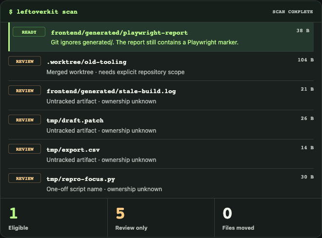

# LeftoverKit

**AI is done. What’s left in your repo?**

One read-only scan finds old test reports, logs, temporary scripts, patches and Git worktrees. See why each item surfaced and how much space it takes.

**[Try the online demo](../../deployments/activity_log?environments_filter=github-pages) · [Scan my repo](#scan-your-existing-checkout) · [中文](docs/README.zh-CN.md)**

[](../../deployments/activity_log?environments_filter=github-pages)

This Playwright report sits under a Git-ignored folder. LeftoverKit spotted the report's marker on its first pass. This replay uses a synthetic checkout with zero registered files.

## Scan your existing checkout

From the checkout you want to inspect, paste this into a shell on macOS or Linux with Python 3.11+, Git, `curl` and `uv`.

```sh
repo=$(curl -fsSL https://api.github.com/repositories/1471583448 |
  python3 -c 'import json, sys; print(json.load(sys.stdin)["clone_url"])') &&
  uvx --from "git+$repo" leftoverkit scan
```

The scan shows what it found, the evidence and the measured size. It writes no LeftoverKit state. It also works without `lsof` and reports that open files could not be verified. Add `--json` for the full machine-readable output.

| Result | Meaning |
| --- | --- |
| **Ready** | A known generated report or a registered artifact in the selected scope qualified for cleanup. |
| **Review** | Evidence suggests a leftover, or broader scope is needed. The default cleanup leaves it in place. |
| **Kept** | A hold, Git state, open process, age threshold or another protection blocked cleanup. |

To reproduce discovery in a disposable checkout with **no scratch allocations or registered files**, see the [first-scan case](docs/DEMO.md).

## Clean up when you choose

With LeftoverKit [installed from source](#install-and-develop), `leftoverkit clean` applies the ready entries in the current checkout's unscoped workspace. To clear a single agent task, use its ID for every operation:

```sh
leftoverkit start --json
leftoverkit scratch --task TASK_ID --json
# Put throwaway files in the returned directory, then mark it finished.
leftoverkit finish --task TASK_ID SCRATCH_ID
leftoverkit scan --task TASK_ID
leftoverkit clean --task TASK_ID
leftoverkit batches --task TASK_ID
leftoverkit undo --task TASK_ID
```

A task from another checkout, or another task in the same checkout, is outside that scope. Use `--repo` explicitly from the primary checkout to include eligible linked worktrees and shared scratch allocations. [Scope and recovery rules](docs/DESIGN.md)

## Install and develop

From a local copy of this project's source:

```sh
uv tool install .
leftoverkit install  # optional Codex and Claude Code skill
```

The skill allocates a task and carries its ID. It can register exact artifact paths it created. Ordinary untracked application source is rejected by `register`. For one-off code, use allocated scratch. The runtime integrations still rely on the agent to follow these instructions.

Quarantine moves files out of the workspace while keeping a copy on disk. Run `leftoverkit batches` to inspect recoverable items, or `leftoverkit config --init` to set retention and scan limits. `purge` is the separate, permanent space-reclaim operation. Worktree branches stay checked out until the quarantined worktree is restored or purged.

[中文说明](docs/README.zh-CN.md) · [Discovery and recovery cases](docs/DEMO.md) · [Verification](docs/VERIFICATION.md)

```sh
uv run --with pytest pytest -q
uv build
```

MIT licensed.
