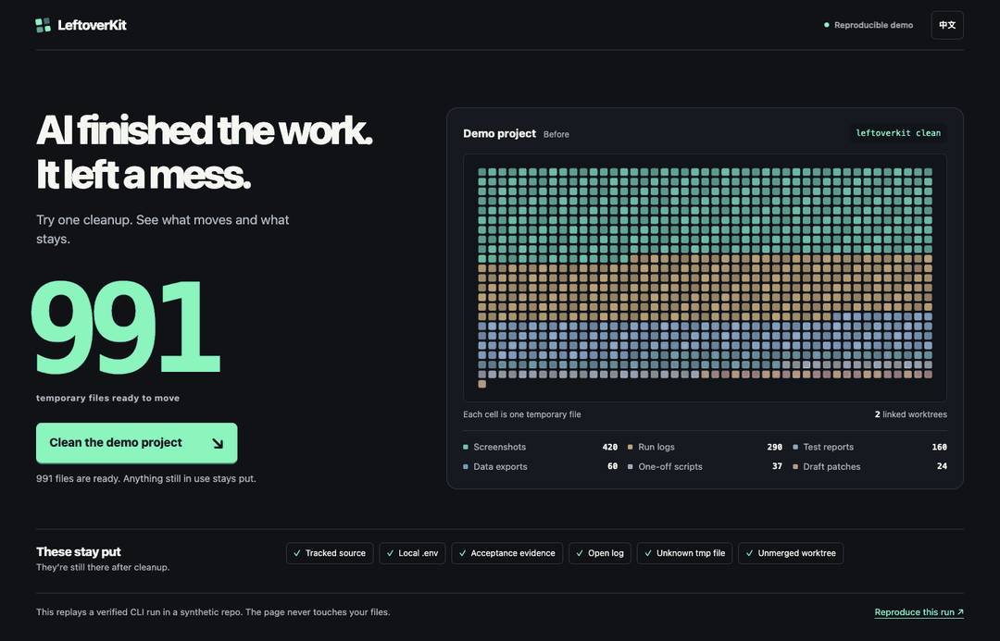

# See 991 files disappear

Open [`docs/demo.html`](demo.html) in a browser from a local checkout. Click **Clean the demo project**, then **Undo cleanup**. The file map, file counts and worktree count replay a run that was executed with the real CLI. The browser operates on bundled fixture data.



## Run the same case

```sh
uv tool install .
python3 scripts/showcase_fixture.py
```

The script creates a disposable Git project, a sibling system temp directory, six categories of temporary files and two worktrees. It checks the bytes of all 991 files after restoring them. Tracked source, local configuration, delivered evidence, an unknown temp file and a log held open by a real subprocess stay in place. The worktree with a unique commit stays too.

| Replay | Measured result |
| --- | --- |
| Before | 991 eligible temporary files and 2 linked worktrees |
| After | 0 of those files in their original locations, 1 worktree left in place |
| Undo | 991 files restored and the moved worktree restored on its original branch |

To rebuild the browser data, use `python3 scripts/showcase_fixture.py --browser-data docs/showcase/evidence.js`. The shorter smoke test is `python3 scripts/demo.py`.
