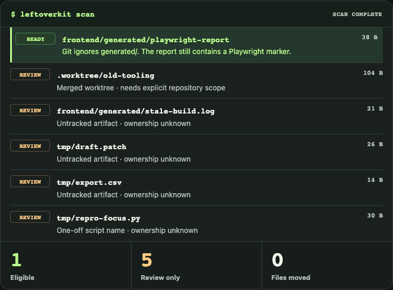

# Try discovery before cleanup

## Watch the first scan

[](../../../deployments/github-pages)

Open the repository's [GitHub Pages deployment](../../../deployments/github-pages) and click **View deployment** to play the scan in your browser. The repository's **About** link goes straight to the replay.

Click **Run demo scan** to see the Playwright report under the Git-ignored `generated/` directory. The recorded CLI run found **one eligible item and five for review**, and moved **zero files** in a synthetic checkout with zero registrations. The [self-contained HTML](first-scan.html?raw=1) also plays offline.

## Reproduce it

Run the case from the LeftoverKit source checkout after installing its CLI.

```sh
python3 scripts/discovery_fixture.py
```

The fixture creates an existing-style Git repository. It does not call `scratch` or `register`. It contains an ignored-parent Playwright report, an old build log, an untracked diagnostic script and patch, tracked source, a private config file and a worktree with ignored dependencies. It verifies which items are ready, advisory and protected. It also confirms that `scan` writes no state.

Refresh the recorded data with `python3 scripts/discovery_fixture.py --replay docs/first-scan.html`.

For a real checkout, run `leftoverkit scan` from that project. The result shows evidence rather than guessing who created each file. Review-only artifacts stay in place.

## What the earlier 991-file replay tests

The [interactive replay](demo.html) demonstrates rollback of **five known objects** in a synthetic project. Those objects contain 991 files and one worktree. Most files were in managed scratch or a prepared report directory. The replay proves isolation and byte-for-byte restoration. It does not measure first-scan discovery, runtime, or disk space saved.

To run that recovery case, use `python3 scripts/showcase_fixture.py`. The quick recovery smoke test is `python3 scripts/demo.py`.
