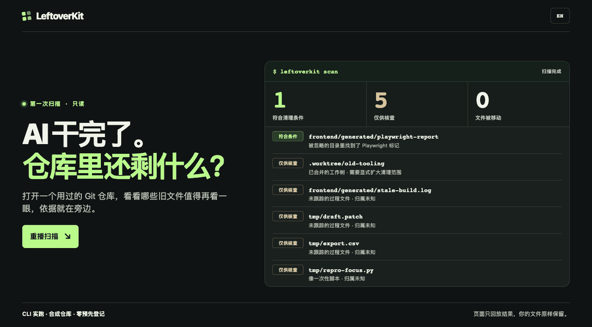

# LeftoverKit

**AI 干完了，仓库里还剩什么？**

把旧日志、补丁、临时脚本、测试报告和工作树扫一遍。每条发现都有依据和体积，首次扫描只读。

[](DEMO.md#watch-the-first-scan)

[扫描自己的仓库 ↓](#先试只读扫描) · [看扫描回放](DEMO.md#watch-the-first-scan)

## 先试只读扫描

适用于 macOS 和 Linux，需要 Python 3.11+、Git 和 `uv`。从本开源仓库的 **Code** 菜单复制 HTTPS 地址，然后在**想检查的项目**里运行：

```sh
uvx --from 'git+这里粘贴开源仓库的HTTPS地址' leftoverkit scan
```

扫描不会写清理记录，也不会移动文件。安装版可直接运行 `leftoverkit scan`。用 `--json` 可以查看完整结果。

## 清理和恢复

默认的 `clean` 只处理当前 checkout 里符合规则的未分配任务产物。并行使用时，把任务 ID 带到 `scan`、`clean`、`batches` 和 `undo`。其他任务的产物会留在原处。想从主 checkout 清理已合并的闲置工作树或共享 scratch 时，显式加 `--repo`。

如果你已经克隆了 LeftoverKit，从这个工具的源码目录执行：

```sh
uv tool install .
leftoverkit install
```

第二条用于安装 Codex 和 Claude Code 的 skill。隔离中的文件还能恢复，磁盘空间要等明确执行到期的 `purge` 才会释放。工作树隔离期间，Git 分支仍被该工作树占用。

[从零登记的扫描案例](DEMO.md) · [技术边界](DESIGN.md) · [验证记录](VERIFICATION.md)
